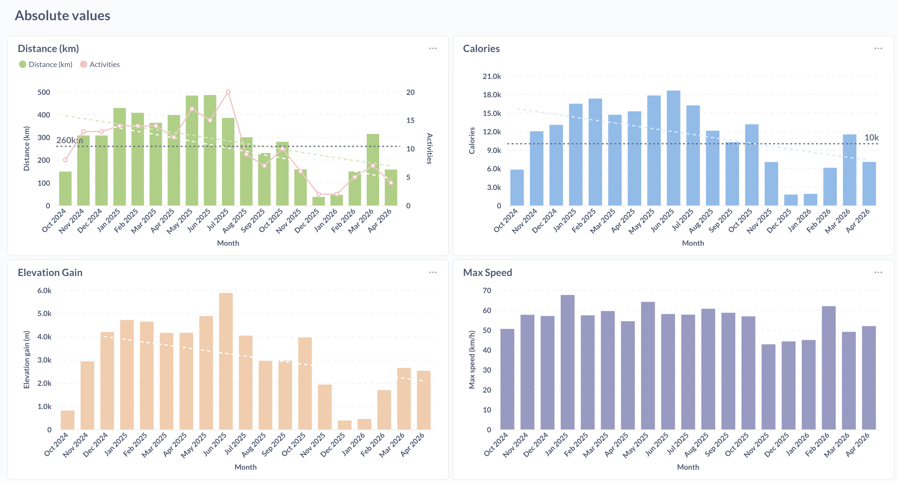

# What's this about
A project to learn Python+Django by creating a small web app to track my Strava Ride activities.

# Why
On one hand, I am learning Python+Django.

On the other hand, I want to keep track of my personal Strava Ride activities and be able to visualize data in ways which are not always present in Strava nor Garmin Connect.

So, why not?
It's a good excuse to learn something new and useful, while being able to view my Ride data in the way I want.

# What does it do?
- Loads one Strava athlete and syncs all Ride activities
- Real-time sync via Strava webhook (`create` / `update` / `delete`)
- Auto-renames generic activity names (e.g. "Morning Ride" → "Cornellà - [Molins] - Turó d'en Pisca - Cornellà ~8km spacing") using Overpass (peaks/saddles) + Nominatim (municipalities) reverse-geocoding
- Public paginated activity list, plus a staff-only dashboard and a staff-only charts page (embedded Grafana)
- Detects missing activities and provides one-click sync to backfill them
- Django admin with custom bulk actions: re-trigger auto-rename, force auto-rename
- Optional Metabase/Grafana containers via `docker-compose.yml` for ad-hoc visualisations
- Test suite with 90+ pytest tests (mocking external HTTP)

# How does it look like?


> Note: screenshot is from an earlier version of the dashboard — TODO refresh.

# Known issues and limitations
- Only one user supported.
- Render free tier sleeps after 15 min idle → the first webhook after sleep may miss; Strava retries automatically over the following hours.
- Geocoding (Nominatim) can be non-deterministic on administrative boundary coordinates — a point on a municipal border may resolve to one side or the other at different times. Rare; the force auto-rename admin action can be used to re-roll if needed.

# Next steps
- Improve visualisations of the data (e.g., total distance per month, average speed, calories per month).

# How to use this project
## On Strava
- Enable the Strava API. As of this writing, go to https://www.strava.com/settings/api and create an app.

## Locally
- Make sure you have Python and uv installed (https://github.com/astral-sh/uv))
  - And docker for Metabase
- Clone this repo
- `cd` into the project folder and run the following commands:
  - `uv venv --seed`
  - `source .venv/bin/activate`
  - `uv sync`
- Initialize the environment variables. Create a `.env` file in the project root with the following variables:
  - `STRAVA_CLIENT_ID=your_strava_client_id`
  - `STRAVA_CLIENT_SECRET=your_strava_client_secret`
  - `STRAVA_REFRESH_TOKEN=your_strava_refresh_token` (the access token is minted from this at runtime and cached automatically — you don't set `STRAVA_ACCESS_TOKEN` yourself)
  - `DB_NAME`=stravagancia 
  - `DB_USER`=strava 
  - `DB_PASSWORD`=strava 
  - `DB_HOST`=localhost 
  - `DB_PORT`=5432
- Initialize the database and load data:
  - `docker compose up -d postgres`
  - `python manage.py migrate`
  - `python manage.py createsuperuser`
  - `python test_strava_connection.py` (to verify Strava API access)
  - `python manage.py load_athlete`
  - `python manage.py detect_missing_activities`
  - `python manage.py load_missing_activities`: may take a while depending on how many activities you have
- Run isolated tests with local PostgreSQL: see [TESTING.md](TESTING.md).
- To exercise the webhook end-to-end with a real Strava upload (requires `activity:write` scope on the refresh token):
  - `python manage.py upload_test_gpx path/to/ride.gpx`
- Optionally: run the dashboard containers via Docker:
  - `docker compose up -d grafana metabase` → Metabase on port 3000, Grafana on port 3001. (Plain `docker compose up` starts every service, including the `django` container, which is wired to the production Neon DB.)
- Optionally: run the Django development server:
  - `python manage.py runserver`
  - Access the admin interface at http://localhost:8000/admin using the superuser credentials created before.
  - Some basic URLs are already wired up in strava_integration/urls.py for exploration.

Auth in metabase:
- email: admin@admin.com  
- password: django-strava-01

## In production (Render + Neon)

This project runs on Render's free tier (Docker service) with a Neon Postgres database. (The live app URL is intentionally kept out of this public repo to avoid drive-by pings that would keep the free-tier service awake.)

- The service container builds from `Dockerfile` and runs `entrypoint.sh` (migrate, create superuser, collectstatic, gunicorn).
- Auto-deploys on `git push origin main`.
- Env vars set on Render:
  - `STRAVA_REFRESH_TOKEN` (only the refresh token — access tokens are minted on each call by `utils.refresh_access_token`)
  - `STRAVA_CLIENT_ID`, `STRAVA_CLIENT_SECRET`
  - `STRAVA_WEBHOOK_VERIFY_TOKEN`
  - `DATABASE_URL` (Neon connection string)
  - `SECRET_KEY`, `ALLOWED_HOSTS`
  - Optional: `DJANGO_SUPERUSER_USERNAME`, `DJANGO_SUPERUSER_PASSWORD`, `DJANGO_SUPERUSER_EMAIL` (used once by `entrypoint.sh` to create the admin user on first boot).

### Keep-alive (avoiding Render's 15-min sleep)

Render's free tier puts the service to sleep after 15 min of inactivity, which adds a ~30s cold start on the first request and can cause Strava webhooks to miss the 2s timeout (Strava retries, so events still arrive eventually).

A **Cloudflare Worker** (free) pings `GET /healthz/` every 12 min on a Cron Trigger, but only during **09:00–23:59 Europe/Madrid** (enforced in the Worker code, DST-aware), so the service still sleeps overnight. Cloudflare cron fires regardless of the previous result (no backoff), and the Worker uses a `curl` User-Agent + retries to ride through the cold-start `503` — fixing the failure mode that made the old cron-job.org / GitHub Actions pingers unreliable. Code and details in [`keepalive/`](./keepalive/).

- **Endpoint**: `GET /healthz/` → returns `ok` (200), no DB, no auth. Defined in `strava_integration/views_ui.py` (`healthz`); it logs each hit with the client IP + User-Agent so keep-alive traffic shows up in Render logs.

Why the 750h/month cap matters: Render free tier allows 750h of running time per account per billing cycle. One service awake 24/7 = 720h. Sleeping overnight frees hours for a second service (the Grafana below).

### Dashboards (Grafana on Render)

The `/charts/` page embeds Grafana dashboards. In production, Grafana runs as a **separate Render service** built from [`grafana/Dockerfile`](./grafana/Dockerfile) — provisioned to read the Neon DB, with anonymous read-only access enabled for embedding. The Django `GRAFANA_URL` env var points `/charts/` at it. Locally, `docker-compose.yml` runs Grafana instead.

### Admin login protection

The Django admin login is rate-limited with [django-axes](https://github.com/jazzband/django-axes): 5 failed attempts lock the `(IP, username)` pair for 1 hour, X-Forwarded-For-aware for Render's proxy. Config in `strava_app/settings.py`.

The admin uses the [django-unfold](https://unfoldadmin.com/) theme (configured in `strava_app/settings.py` under `UNFOLD`; the custom `ModelAdmin`s in `strava_integration/admin.py` extend Unfold's).

## Private Garage photos (prepared locally, external validation pending)

Bike and item detail pages support private JPEG/PNG/WebP uploads, replacement and
deletion. The server processes images with `garage.photos`; PostgreSQL stores
only opaque object references, dimensions, processed byte counts and SHA-256.
Original filenames, signed URLs and storage credentials are never stored there.
The protected content endpoint authorizes the owner before issuing a short-lived
GET URL. Even superusers cannot access another owner's photo through Garage.

The private bucket and branch-scoped credentials must be authorized and configured
separately; no bucket, credential or deployment was created for this work. Required
server variables are `GARAGE_S3_ENDPOINT_URL`, `GARAGE_S3_REGION`,
`GARAGE_S3_BUCKET`, `GARAGE_S3_ACCESS_KEY_ID` and `GARAGE_S3_SECRET_ACCESS_KEY`.
See [storage configuration](docs/garage-storage.md). Missing configuration shows a
generic unavailable message. Do not enable boto3/botocore DEBUG logging or record
signed URLs.

The default ceiling is **250 MiB per owner** and **4,000,000,000 bytes for the
project**. The project ceiling leaves 1 GB of headroom within the documented
5 GB provider allowance. `GARAGE_PHOTO_OWNER_QUOTA_BYTES` and
`GARAGE_PHOTO_PROJECT_QUOTA_BYTES` can set smaller positive integer ceilings in
server environment variables or Django settings; neither may exceed the 4 GB
application ceiling. Reservations, live photos and objects awaiting cleanup all
count. Replacement temporarily reserves both objects and can fail when there is
insufficient headroom. The owner lock serializes reservations; a singleton budget
row also serializes reservations across owners for the project ceiling.

Before a PUT, the service commits an object reservation containing its opaque key
and a cleanup deadline. A second owner-locked transaction performs the bounded
upload and finalizes the photo reference. A failed replacement preserves the old
photo. Successful replacement/deletion marks the detached object for cleanup;
failed cleanup remains durable and continues counting toward quota. Writes must
start outside an enclosing transaction; photo endpoints do not use
`ATOMIC_REQUESTS`. The ten-minute reservation deadline lets cleanup recover a
process crash or an ambiguous PUT; cleanup shares the owner lock and never deletes
an object with a database reference. Referenced bikes/items and accounts with
tracked objects are protected from deletion, so raw deletion cannot discard
cleanup metadata. Remove photos and finish cleanup before deleting those resources.

When PUT has no confirmed response, an early best-effort DELETE does not release
the key or quota: the PUT may persist afterward. Its reservation remains for a
ten-minute settle window and requires another cleanup DELETE after that window.
Expired reservations left by crashed uploaders follow the same protocol: the
first acknowledged DELETE defers the job for another settle window and retains
its key and quota. The command reports these jobs as `deferred`; a later due
DELETE must succeed before they count as `deleted`.
Confirmed uploads followed by a DB failure and detached previously live objects
can be cleaned immediately.

Retry only tracked, due objects with this management command; it never lists the
bucket or prints object keys, URLs or credentials:

```bash
python manage.py cleanup_photos --dry-run
python manage.py cleanup_photos --limit 100
python manage.py cleanup_photos --owner OWNER_ID --limit 100
```

Failures increment a safe error code and retry after an increasing delay of up
to one hour. Storage DELETE must succeed and the reservation row must be removed
before application quota is released. Provider usage can differ from this count;
DELETE acknowledgment does not establish physical removal or immediate provider
quota recovery. Provider quotas, other objects and transfer charges still require
deployment checks. No scheduler is installed by this command.

Simulated tests cover upload/read/replace/delete, ownership, quotas, two-connection
concurrency, rollback and recovery with PostgreSQL isolated under [TESTING.md](TESTING.md).
**The real private-bucket test remains pending**: synthetic-image persistence
from a second client, anonymous denial, signed GET, replacement and cleanup.
`garage-010` stays open until the pending external integration is resolved and
documented. No production environment file or Neon data was changed.
